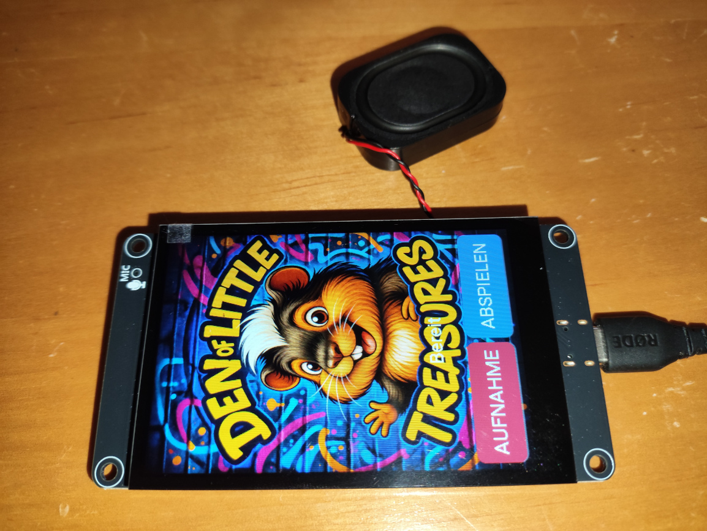
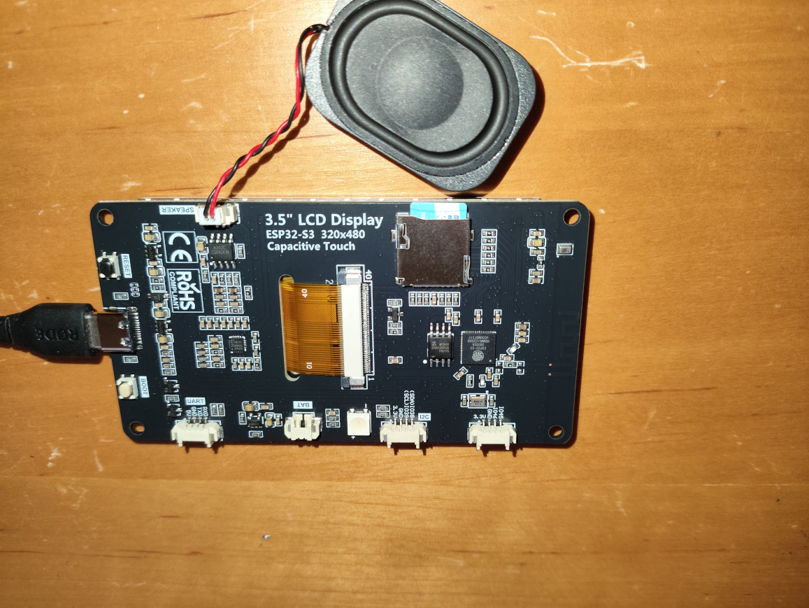

# LCDWiki ES3C35P / WS-32871 – ESPHome-Hardwarereferenz

[English / Hauptseite](../../README.md) · [Pinbelegung](PINBELEGUNG.md) · [Fehlersuche](FEHLERSUCHE.md)

Dieses Repository dokumentiert den **lauffähigen Arbeitsstand der 3,5-Zoll-ESP32-S3-Displayhardware**, als eigenständige Hardware-Demo mit Robby-Motiv. Das Beispiel bietet ein LVGL-Display mit Touchschaltflächen, ES8311-Audio, 48-kHz-WAV-Aufnahme/Wiedergabe, microSD und WAV-Download im lokalen Netz.

**Stand 08.11.2026:** Die zugrunde liegenden Funktionen wurden mit **ESPHome 2026.9.0** an einem realen Board getestet: Display, Touch, 32-GB-FAT32-microSD, Mikrofon, Lautsprecher und WAV-Download. **Die umbenannte und neu verpackte Repository-YAML wurde noch nicht separat kompiliert oder aufgespielt; die zugrunde liegende 48-kHz-Hardwarekonfiguration wurde am Gerät getestet.** Hardwarevarianten können abweichen.

## Hardwarefotos

Die folgenden Fotos zeigen das tatsächlich verwendete **LCDWiki ES3C35P / WS-32871** mit ESP32-S3, 3,5-Zoll-IPS-Display und den Anschlüssen auf der Platinenrückseite.

| Vorderseite – 3,5-Zoll-Display | Rückseite – ESP32-S3-Platine |
|:---:|:---:|
|  |  |

**Hardware:** LCDWiki ES3C35P / WS-32871  
**Mikrocontroller:** ESP32-S3  
**Display:** 3,5 Zoll IPS, 320 × 480 Pixel  
**Speicher:** 16 MB Flash / 8 MB PSRAM

Weitere technische Informationen findest du in der [Pinbelegung](PINBELEGUNG.md) und in der [Anschlussdokumentation](../CONNECTORS.md).

## Funktionsstand

| Baugruppe | Technischer Stand | Nachweis |
|---|---|---|
| ESP32-S3 | 16 MB Flash, 8 MB Octal-PSRAM | Gerät/Logs |
| Display | ST77922, 320×480, QSPI 40 MHz | getestet |
| Touch | ST7123, I²C `0x55`, Reset GPIO48 | getestet |
| Hintergrundbeleuchtung | GPIO41, PWM/LEDC | getestet |
| Codec | ES8311, I²C `0x18` | getestet |
| Mikrofon | natives ESPHome-I²S, 48 kHz, 16 Bit, mono | WAV aufgenommen |
| Lautsprecher | 48 kHz, 16 Bit, mono | korrekte Wiedergabe getestet |
| Verstärker | SC8002B, GPIO1 **LOW aktiv** | getestet |
| microSD | 4-Bit-SDMMC, FAT32, `/sdcard` | getestet |
| WAV-Download | HTTP-Port 8080 | getestet |
| RGB-LED, Akku, Erweiterungen | Pinbelegung dokumentiert | noch nicht getestet |

## Dateien

```text
README.md                              englische Hauptseite
esphome/es3c35p-hardware-demo.yaml    Hardware-Demo mit Robby-Bild
esphome/robby_display.png             Robby-Motiv für die Anzeige
esphome/includes/guinea_sd_test.h     SDMMC/FAT-Mount
esphome/includes/guinea_native_wav.h  WAV-Aufnahme/Wiedergabe, 48-kHz-Fix
esphome/includes/guinea_wav_web.h     HTTP-WAV-Download
docs/en/                             englische Zusatzdokumentation
docs/de/                             diese deutsche Dokumentation
```

Die Header-Dateinamen und Namespaces behalten aus Kompatibilitätsgründen die Kennung `guinea_`. Es handelt sich um interne Bezeichner; die Demo ist eigenständig. **Das Robby-Bild ist Bestandteil der Beispieloberfläche.**

## Installation mit ESPHome

1. **Original-Firmware sichern**, bevor du das Gerät flashst. Vollständige Flashabbilder niemals ungeprüft öffentlich teilen: WLAN-Daten oder Geheimnisse können enthalten sein.
2. ESPHome **2026.9.0** oder kompatibel verwenden, ESP-IDF-Framework.
3. `esphome/es3c35p-hardware-demo.yaml` in deinen ESPHome-Konfigurationsordner kopieren. Den Unterordner `includes/` daneben belassen. In der lokalen `secrets.yaml` die Einträge `wifi_ssid` und `wifi_password` bereitstellen.
4. FAT32-microSD einlegen. Die Firmware **formatiert niemals automatisch**.
5. Prüfen, kompilieren, installieren, Logs lesen:

```bash
esphome config es3c35p-hardware-demo.yaml
esphome compile es3c35p-hardware-demo.yaml
esphome run es3c35p-hardware-demo.yaml
esphome logs es3c35p-hardware-demo.yaml
```

Im ESPHome-Dashboard geht es alternativ über **Installieren** und **Logs**. Der erste Flash erfolgt ggf. per USB/Bootmodus, später ist OTA möglich.

## Bedienung

- **RECORD** einmal drücken: Aufnahme starten. Nochmals drücken: beenden. Datei: `/sdcard/aufnahme.wav` – die vorige Aufnahme wird überschrieben.
- **PLAY**: Datei über den Lautsprecher abspielen.
- **Lautstärke und Mikrofon-ADC-Gain**: als ESPHome/Home-Assistant-Entitäten einstellbar. Gain-Schieberegler schreibt Codec-Register `0x17` (0–32 dB im getesteten Aufbau).
- **Download:** `http://<geraete-ip>:8080/` im lokalen Netz. Keine Anmeldung, kein HTTPS: **nicht ins Internet freigeben**.

### Warum 48 kHz an zwei Stellen wichtig sind

Eine 48-kHz-Angabe im WAV-Header genügt nicht. Bei einem früheren Test wurde eine korrekt aufgenommene Datei über den Lautsprecher **zu langsam** abgespielt. Die Lösung war die explizite Streaminformation `AudioStreamInfo(16, 1, 48000)` im Header `guinea_native_wav.h`. Die Logmeldung `Slot bit width: 16` beschreibt die I²S-Bitbreite, nicht die Wiedergabegeschwindigkeit.

48 kHz ermöglichen theoretisch Frequenzen bis 24 kHz; die tatsächliche Mikrofonempfindlichkeit ist **nicht kalibriert**. Ein Vergleich mit einem abgespielten Pfeiflaut zeigte wiedererkennbare hochfrequente Muster, beweist aber keinen linearen Frequenzgang.

## Unterschiede zu anderen Projekten

Ein besonderer Dank geht an **[jlmeredith/ES3C35P](https://github.com/jlmeredith/ES3C35P)**. Dort sind die Display-/Touch-Ansteuerung, die Fehler in Herstellerunterlagen, die Initialisierung und die Reset-Besonderheiten sehr sorgfältig dokumentiert. **Unser zusätzlicher Schwerpunkt** ist der praktisch erprobte vollständige Audio-/SD-Weg: ES8311-Mikrofon, native 48-kHz-I²S-Aufnahme, korrekte Lautsprecherwiedergabe, 4-Bit-microSD, ADC-Gain und einfacher HTTP-Download. Das ist eine Ergänzung, keine Behauptung, dass die andere Arbeit diese Funktionen grundsätzlich nicht unterstützt.

## Hersteller und Quellen

- [LCDWiki-Herstellerseite mit Starterpaket, Schaltplan und Anleitungen](https://www.lcdwiki.com/3.5inch_ESP32-S3_Display)
- [LCDWiki-Dateiverzeichnis](https://www.lcdwiki.com/res/ES3C35P/)
- [jlmeredith/ES3C35P](https://github.com/jlmeredith/ES3C35P)
- [Xiaozhi-Boardcode](https://github.com/78/xiaozhi-esp32/tree/main/main/boards/lcdwiki-es3c35p)
- [ESPHome MIPI-SPI](https://esphome.io/components/display/mipi_spi/), [ESPHome ST7123](https://esphome.io/components/touchscreen/st7123/)

## Hinweise zur Veröffentlichung

Dieses Paket enthält **keine** originale Hersteller-Firmware, kein komplettes Flashabbild, keine WLAN-Zugangsdaten, keine privaten WAV-Dateien und keine fremden Grafiken ohne ausgewiesene Herkunft. Das enthaltene Robby-Demobild ist gesondert vom Programmcode zu betrachten. Die ST77922-Registertabelle ist in den LCDWiki-Beispielen dokumentiert und laut [jlmeredith/ES3C35P](https://github.com/jlmeredith/ES3C35P) ebenfalls in der originalen Gerätefirmware enthalten. Unsere ESPHome-Darstellung entspricht der dort dokumentierten Registerfolge; Details unter [Herkunft](HERKUNFT.md). Die Tabelle dient der Hardware-Kompatibilität; damit wird keine pauschale Lizenz für sämtliche Herstellerdateien behauptet. Drittmaterial wird hier nicht als eigenes Werk beansprucht.

## Lizenz und Robby-Bild

Der eigene Programmcode und die eigene Dokumentation stehen unter der [MIT-Lizenz](../../LICENSE), **soweit die erforderlichen Rechte beim Repository-Inhaber liegen**. Für Bestandteile Dritter gelten deren jeweilige Lizenz- und Herkunftshinweise; siehe [Herkunft](HERKUNFT.md).

**Ausnahme – Robby-Bild:** `esphome/robby_display.png` ist **nicht** MIT-lizenziert. **Copyright © 2026 AndiBcool. Alle Rechte vorbehalten.** Das unveränderte Bild darf **nur als Bestandteil dieses unveränderten ES3C35P-Demo-Repositories** heruntergeladen und weitergegeben sowie zum Ausführen, Testen und Vorführen der enthaltenen ES3C35P-Hardware-Demo genutzt werden. Für andere Projekte, eine eigenständige Weitergabe, Bearbeitung oder kommerzielle Verwertung des Bildes ist vorher eine schriftliche Genehmigung erforderlich. Diese Ausnahme schränkt den MIT-lizenzierten Code nicht ein. Siehe [Robby-Bildlizenz](../../esphome/ROBBY-LICENSE.md).

